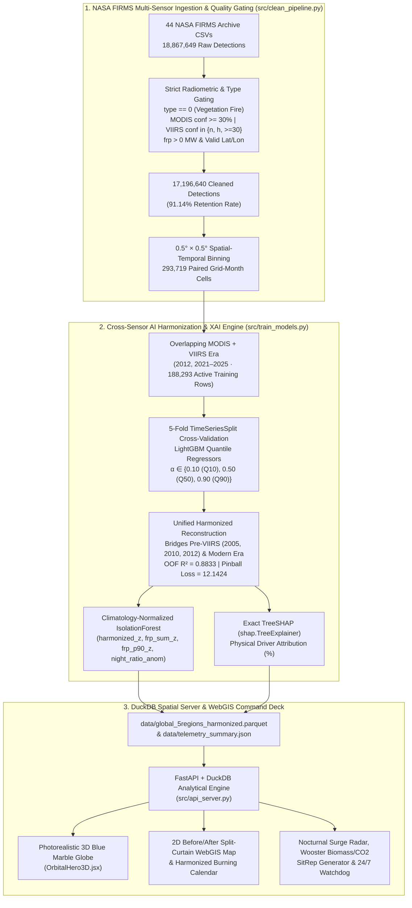

# EAGLES OF HORUS — Cross-Sensor MODIS & VIIRS Wildfire Intelligence, Quantile Harmonization & Explainable AI WebGIS

> **NASA Space Apps Challenge Technical Memorandum**  
> **Challenge**: *Harmonization of MODIS and VIIRS Hot Spots*  
> **Target Global Fire Basins**: United States (`USA`), Canada (`Canada`), Brazil (`Brazil`), Greece (`Greece`), and Australia (`Australia`)  
> **Processed Archive**: `44` NASA FIRMS CSV archives · `18,867,649` raw satellite detections · `17,196,640` quality-gated vegetation fire detections (`91.14%` retention) · `293,719` spatiotemporal $0.5^\circ \times 0.5^\circ$ grid-month cells  
> **Cross-Sensor Validation**: 5-Fold `TimeSeriesSplit` Out-of-Fold $R^2 = 0.8833$ · Median Pinball Loss $\mathcal{L}_{0.50} = 12.1424$

---

## 1. Executive Summary & Scientific Motivation

Satellite active-fire records from NASA's **MODIS** (*Moderate Resolution Imaging Spectroradiometer* aboard Terra and Aqua, $1\text{ km}$ nadir spatial resolution) and **VIIRS** (*Visible Infrared Imaging Radiometer Suite* aboard Suomi-NPP and NOAA-20, $375\text{ m}$ nadir spatial resolution) form the backbone of global wildfire monitoring. However, directly combining raw MODIS and VIIRS hotspot counts introduces a severe **cross-sensor discontinuity**:

1. **Spatial Footprint Disparity ($1\text{ km}^2$ vs. $0.14\text{ km}^2$)**: Because a $375\text{ m}$ VIIRS pixel covers an area $\approx 7.1\times$ smaller than a $1\text{ km}$ MODIS pixel, VIIRS resolves smaller, cooler, and perimeter-fragmented thermal plumes that sub-pixel average below the MODIS detection threshold—yielding **$\sim 3.5\times \text{ to } 5.1\times$ more raw detections** over identical fire events.
2. **Pre-VIIRS Historical Gap (`2005`, `2010`, `2012`)**: VIIRS S-NPP launched in late 2011 (`2012` full operational record), and NOAA-20 (JPSS-1) launched in late 2017. Consequently, historical benchmark years (`2005` and `2010` in North America) lack VIIRS observations entirely (`raw_viirs = 0`), while `2012` lacks secondary JPSS constellation coverage.
3. **Diurnal-to-Nocturnal Radiative Shift**: Nighttime overpasses (`daynight = 'N'`) exhibit markedly different thermal background contrast and sensor saturation profiles across MODIS and VIIRS channels.

**Eagles of Horus** resolves these physical discrepancies by harmonizing MODIS and VIIRS onto a unified $0.5^\circ \times 0.5^\circ$ monthly spatial-temporal mesh using **Distribution-Free Quantile Gradient Boosting (`LightGBM` at $\alpha \in \{0.10, 0.50, 0.90\}$)**, **Climatology-Normalized `IsolationForest` Anomaly Detection**, and **`shap.TreeExplainer` Explainable AI (XAI)**—delivered through a synchronized **Photorealistic 3D Orbital Globe + 2D Split-Screen WebGIS Command Deck**.

---

## 2. System Architecture & Data Pipeline (`Mermaid.js`)



---

## 3. Mathematical Formulation

### 3.1 Spatial-Temporal Grid Aggregation ($0.5^\circ \times 0.5^\circ$)

Each quality-gated satellite detection $i$ at coordinates $(\text{lat}_i, \text{lon}_i)$ and timestamp $t_i \in (\text{year } y, \text{month } m)$ is snapped to a deterministic $0.5^\circ \times 0.5^\circ$ planetary cell:

$$
\text{lat\_bin}_i = 0.5 \cdot \lfloor 2 \cdot \text{lat}_i \rfloor, \qquad \text{lon\_bin}_i = 0.5 \cdot \lfloor 2 \cdot \text{lon}_i \rfloor
$$

To preserve seasonal phase continuity across the December–January boundary, month $m \in \{1, \dots, 12\}$ is encoded on the unit circle:

$$
\text{sin\_month} = \sin\!\left(\frac{2\pi m}{12}\right), \qquad \text{cos\_month} = \cos\!\left(\frac{2\pi m}{12}\right)
$$

For each cell-month tuple $c = (\text{country}, y, m, \text{lat\_bin}, \text{lon\_bin})$, we extract the 9-dimensional physical feature vector $\mathbf{x}_c \in \mathbb{R}^9$:

$$
\mathbf{x}_c = \Big[ \text{raw\_modis},\; \text{modis\_frp\_sum},\; \text{modis\_frp\_p90},\; \text{modis\_night\_fire\_ratio},\; \text{modis\_brightness\_mean},\; \text{lat\_bin},\; \text{lon\_bin},\; \text{sin\_month},\; \text{cos\_month} \Big]^\top
$$

### 3.2 `LightGBM` Quantile Harmonization ($\alpha \in \{0.10, 0.50, 0.90\}$)

Rather than fitting an ordinary least-squares multiplier that collapses under heteroscedastic megafire tails, we train three gradient-boosted decision tree ensembles $\hat{f}_\alpha(\mathbf{x}_c)$ for $\alpha \in \{0.10, 0.50, 0.90\}$ by minimizing the asymmetric **Pinball (Check) Loss** against the $375\text{ m}$ VIIRS ground-truth count $y_c = \text{raw\_viirs}_c$:

$$
\mathcal{L}_\alpha(y_c, \hat{f}_\alpha(\mathbf{x}_c)) = \max\!\Big( \alpha \big(y_c - \hat{f}_\alpha(\mathbf{x}_c)\big),\; (\alpha - 1)\big(y_c - \hat{f}_\alpha(\mathbf{x}_c)\big) \Big)
$$

This yields both the **median harmonized fire activity** $\hat{y}_{c,0.50}$ (`harmonized`) and a calibrated **80% Predictive Confidence Interval**:

$$
\text{CI}_{80\%}(c) = \big[\,\hat{y}_{c,0.10}\; (\text{harmonized\_low}),\;\; \hat{y}_{c,0.90}\; (\text{harmonized\_high})\,\big]
$$

Enforced monotonicity guarantees $\hat{y}_{c,0.10} \le \hat{y}_{c,0.50} \le \hat{y}_{c,0.90}$ across all $293,719$ grid cells, seamlessly reconstructing pre-VIIRS benchmark years (`2005`, `2010`, and `2012`) onto the modern $375\text{ m}$ VIIRS scale.

### 3.3 Climatology-Normalized `IsolationForest` Anomaly Detection

To prevent naturally high-activity savanna or tropical basins from dominating anomaly flags over temperate Mediterranean forests, cell-month telemetry is first standardized against each region's own monthly climatological mean $\mu_{\text{country},m}$ and standard deviation $\sigma_{\text{country},m}$:

$$
z_{\text{harm}}(c) = \frac{\hat{y}_{c,0.50} - \mu_{\text{harm}}(\text{country}, m)}{\sigma_{\text{harm}}(\text{country}, m) + \epsilon}, \qquad \Delta_{\text{night}}(c) = \text{night\_fire\_ratio}_c - \mu_{\text{night}}(\text{country}, m)
$$

An `IsolationForest` ensemble ($\text{n\_estimators}=200$, $\text{contamination}=0.06$) is fit on the 4-dimensional anomaly vector $\mathbf{z}_c = [z_{\text{harm}},\, z_{\text{frp\_sum}},\, z_{\text{frp\_p90}},\, \Delta_{\text{night}}]^\top$, mapping average path lengths $E(h(\mathbf{z}_c))$ into a normalized `[0, 1]` **Anomaly Severity Score** (`anomaly_severity`).

### 3.4 Exact `TreeSHAP` Physical Attribution (`shap.TreeExplainer`)

For every country and seasonal cycle, we compute exact tree-based Shapley additive explanations $\phi_j(\mathbf{x}_c)$ on the median harmonizer $\hat{f}_{0.50}$:

$$
\hat{f}_{0.50}(\mathbf{x}_c) = \mathbb{E}[\hat{f}_{0.50}(\mathbf{X})] + \sum_{j=1}^{9} \phi_j(\mathbf{x}_c), \qquad \text{Attribution}_j(\%) = 100 \cdot \frac{\mathbb{E}_c\big[|\phi_j(\mathbf{x}_c)|\big]}{\sum_{k=1}^{9} \mathbb{E}_c\big[|\phi_k(\mathbf{x}_c)|\big]}
$$

Across all 5 global basins, `TreeSHAP` reveals that after primary MODIS hotspot density (`68.91%–73.05%`), **Nocturnal Fire Ratio (`modis_night_fire_ratio`, `4.83%–10.63%`)** and **Radiative Power (`modis_frp_sum`, `3.94%–6.69%`)** are the dominant physical drivers of cross-sensor scaling.

### 3.5 Wooster et al. (2005) Radiative Biomass Combustion & $\text{CO}_2\text{e}$ Model

Following Wooster et al. (*Journal of Geophysical Research*, 2005) and Andreae & Merlet (*Global Biogeochemical Cycles*, 2001), integrated Fire Radiative Power ($\text{FRP}$, in $\text{MW} = \text{MJ/s}$) over effective satellite overpass windows ($\Delta t_{\text{eff}} = 1{,}200\text{ s}$) is converted into dry biomass combusted ($M_{\text{biomass}}$) and $\text{CO}_2$ equivalent emissions ($M_{\text{CO}_2}$):

$$
\text{FRE}_{\text{MJ}} = \sum \text{FRP}_{\text{MW}} \cdot \Delta t_{\text{eff}}, \qquad M_{\text{biomass (kg)}} = 0.368\text{ kg/MJ} \times \text{FRE}_{\text{MJ}}, \qquad M_{\text{CO}_2\text{ (kg)}} = 1.569 \times M_{\text{biomass (kg)}}
$$

---

## 4. Five-Country Benchmark Validation Table

Strict audit across our `44` NASA FIRMS CSV archives (`18,867,649` raw rows $\rightarrow$ `17,196,640` quality-gated rows across `293,719` $0.5^\circ \times 0.5^\circ$ cells):

| Target Region | Exact Benchmark Years | Cleaned MODIS (`1km`) | Cleaned VIIRS (`375m`) | AI Harmonized (`Q50`) | 80% Quantile CI (`[Q10 – Q90]`) | Cumulative FRP (`MW`) | Anomaly Months / Cells | Top `TreeSHAP` Secondary Driver |
| :--- | :--- | ---: | ---: | ---: | :--- | ---: | ---: | :--- |
| **USA** | `2005, 2010, 2012, 2021, 2022, 2023, 2024, 2025` | `846,163` | `2,324,018` | **`3,153,996`** | `[1,669,439 – 5,433,232]` | `40,565,476.5` | `18 mos` / `5,199 cells` | `night_fire_ratio` (`10.63%`) |
| **Canada** | `2005, 2010, 2012, 2021, 2022, 2023, 2024, 2025` | `763,438` | `3,893,760` | **`4,237,623`** | `[2,214,200 – 6,222,388]` | `61,518,040.4` | `17 mos` / `1,828 cells` | `lat_bin` (`7.85%`) / `night_ratio` (`7.40%`) |
| **Brazil** | `2023, 2024, 2025` | `1,063,790` | `3,772,119` | **`3,727,157`** | `[2,322,054 – 5,478,096]` | `40,950,398.2` | `6 mos` / `3,054 cells` | `night_fire_ratio` (`7.45%`) |
| **Greece** | `2023, 2024, 2025` | `5,484` | `18,941` | **`19,301`** | `[12,108 – 35,972]` | `340,789.7` | `7 mos` / `91 cells` | `night_fire_ratio` (`8.18%`) |
| **Australia** | `2023, 2024, 2025` | `827,757` | `3,681,170` | **`3,610,978`** | `[2,191,031 – 5,230,976]` | `38,935,259.4` | `5 mos` / `2,116 cells` | `lon_bin` (`8.28%`) / `frp_sum` (`5.52%`) |

### 5-Fold `TimeSeriesSplit` Cross-Validation Performance (`LightGBM` Quantile Harmonizer)

| CV Fold | Train Rows | Validation Rows | Pinball Loss $\mathcal{L}_{0.10}$ | Pinball Loss $\mathcal{L}_{0.50}$ | Pinball Loss $\mathcal{L}_{0.90}$ | Median MAE (`Q50`) | Out-of-Fold $R^2$ (`Q50`) |
| :---: | ---: | ---: | ---: | ---: | ---: | ---: | ---: |
| **Fold 1** | `31,383` | `31,382` | `3.5875` | `10.7439` | `7.6042` | `21.4878` | `0.8926` |
| **Fold 2** | `62,765` | `31,382` | `5.4305` | `16.5584` | `10.1879` | `33.1169` | `0.8454` |
| **Fold 3** | `94,147` | `31,382` | `4.4670` | `12.3877` | `7.3029` | `24.7755` | `0.9018` |
| **Fold 4** | `125,529` | `31,382` | `2.9573` | `8.2841` | `4.9288` | `16.5681` | `0.8950` |
| **Fold 5** | `156,911` | `31,382` | `4.6920` | `12.7377` | `7.6909` | `25.4754` | `0.8815` |
| **Mean OOF** | **`188,293` Total** | **`31,382 / fold`** | **`4.2269`** | **`12.1424`** | **`7.5429`** | **`24.2847`** | **`0.8833`** |

---

## 5. FastAPI + DuckDB Intelligence Server Endpoints (`src/api_server.py`)

| Method & Route | Description | Key Parameters / Payload |
| :--- | :--- | :--- |
| `GET /health` | Returns service health, DuckDB version, loaded Parquet row count (`293,719`), and model readiness. | None |
| `GET /api/telemetry` | Returns full or country-filtered `telemetry_summary.json` including monthly series, hotspots, and `TreeSHAP` drivers. | `?country=USA\|Canada\|Brazil\|Greece\|Australia` |
| `POST /api/analyze-aoi` | Executes sub-second DuckDB spatial-temporal query over `global_5regions_harmonized.parquet` for any custom bounding box and benchmark year/month range. | `{"country": "Greece", "lat_min": 40.0, "lat_max": 41.8, "lon_min": 25.0, "lon_max": 27.0, "years": [2023], "months": [8]}` |
| `POST /api/watchdog/subscribe` | Registers a 24/7 Orbital Watchdog AOI alert subscription and performs an immediate DuckDB threshold evaluation against `frp_mw` and `anomaly_severity`. | `{"country": "Greece", "frp_threshold_mw": 500, "anomaly_severity_threshold": 0.65, "email": "ops@agency.org"}` |
| `GET /api/export-csv` & `POST /api/export-csv` | Streams filtered $0.5^\circ \times 0.5^\circ$ harmonized telemetry directly from DuckDB as a downloadable `.csv` file. | `?country=USA&min_lat=35&max_lat=42&anomalies_only=true` |

---

## 6. Quickstart & Reproduction Guide

### 6.1 Run the Data Cleaning & ML Harmonization Pipeline (Optional — Precomputed Artifacts Included)
```bash
# 1. Install Python dependencies
pip install -r requirements.txt

# 2. Run LightGBM Quantile Harmonizer, IsolationForest & TreeSHAP pipeline
python -m src.train_models
```

### 6.2 Build the React + Three.js + Leaflet Frontend & Start the Unified Server
```bash
# 1. Install frontend packages and build production bundle
cd frontend
npm install
npm run build
cd ..

# 2. Launch FastAPI + DuckDB server (serves both API and built WebGIS SPA on port 8000)
python -m uvicorn src.api_server:app --host 127.0.0.1 --port 8000
```

For interactive frontend development with hot module replacement:
```bash
cd frontend
npm run dev
```
###https://eagles-of-horus-webgis.vercel.app
