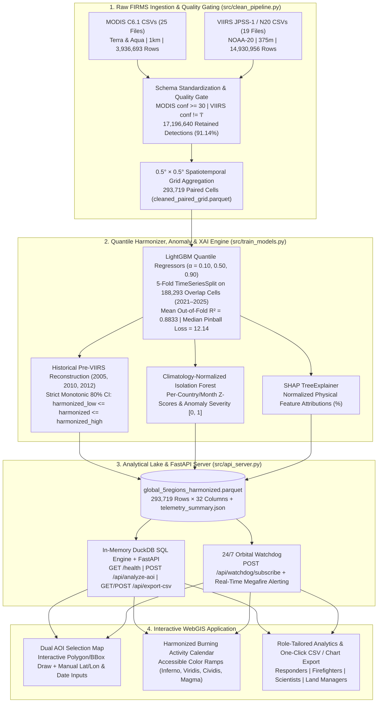

# EAGLES OF HORUS | Cross-Sensor Active Fire Harmonization & Anomaly Intelligence
**Technical Memorandum — 2026 NASA Space Apps Challenge (Giza, Egypt)**  
**Challenge:** Harmonization of MODIS and VIIRS Hot Spots  
**Domain:** Earth Science, Thermal Remote Sensing (MIR/TIR) & Explainable Geospatial ML

---

## 1. Executive Summary & Scientific Motivation

Earth Observation (EO) satellites operating in the mid-infrared (MIR) and thermal infrared (TIR) spectral ranges have tracked active fire hotspots for over two decades. However, emergency responders, fire managers, and scientists face a critical continuity gap across two distinct sensor generations:
1. **MODIS (Terra & Aqua — Collection 6.1):** Provides the foundational historical series from the early 2000s to the present at a **1 km** nadir spatial resolution, now approaching the end of its operational life.
2. **VIIRS (Suomi-NPP, NOAA-20 / JPSS-1, NOAA-21):** Provides operational continuity at **375 m** spatial resolution with substantially higher sensitivity to smaller, lower-intensity, and nighttime combustion—detecting roughly **3.5x to 4.5x more hotspots** per fire event than MODIS.

**Eagles of Horus** bridges this sensor disparity through a modular **Quantile Gradient Boosting (`LightGBM`) Harmonization Pipeline**, **Climatology-Normalized `IsolationForest` Anomaly Detection**, **`TreeSHAP` Explainable AI (XAI)**, and an interactive **DuckDB + FastAPI WebGIS Command Deck**. Once harmonized through our pipeline, the sensor of origin no longer skews historical comparisons, allowing users to explore a consistent **Burning Activity Calendar**, evaluate anomalies against multi-year averages, and export standardized CSV analytics.

---

## 2. System Architecture

---

## 3. Data Engineering & Audit Summary (`src/clean_pipeline.py`)

Our ingestion pipeline audited **44 raw NASA FIRMS CSV datasets** totaling **18,867,649 raw detections**, executing quality gating, coordinate bounding-box verification, and spatiotemporal aggregation in **9.95 seconds** (audit metrics logged in `cleaning_audit.json`).

### 3.1 Sensor Schema Standardization & Quality Gates

| Sensor | Files | Standardized Columns (15) | Date Format | Satellite / Instrument | Confidence Gate | Raw Rows | Cleaned Rows |
| :--- | :---: | :--- | :---: | :---: | :--- | :---: | :---: |
| **MODIS** | 25 | `latitude, longitude, brightness, scan, track, acq_date, acq_time, satellite, instrument, confidence, version, bright_t31, frp, daynight, type` | `YYYY-MM-DD` | `Terra`, `Aqua` / `MODIS` | Integer `0–100` (`confidence >= 30`) | 3,936,693 | 3,506,632 |
| **VIIRS** | 19 | `latitude, longitude, bright_ti4, scan, track, acq_date, acq_time, satellite, instrument, confidence, version, bright_ti5, frp, daynight, type` | `YYYY-MM-DD` | `N20` (JPSS-1) / `VIIRS` | Categorical `'l', 'n', 'h'` (`confidence != 'l'`) | 14,930,956 | 13,690,008 |
| **Total** | **44** | Aliased `bright_ti4` $\rightarrow$ `brightness` | `YYYY-MM-DD` | **MODIS & VIIRS** | **91.14% Retention** | **18,867,649** | **17,196,640** |

### 3.2 Target Regions, Bounding Boxes & Benchmark Years
Detections are filtered to five major fire-regime benchmark regions and aggregated into **`0.5° × 0.5°` grid cells** (`lat_bin`, `lon_bin`) by `(country, year, month)`, yielding **293,719 paired cells**:
* **USA** (`lat: 24.5 to 49.5, lon: -125.0 to -66.5` — CONUS) & **Canada** (`lat: 41.7 to 83.1, lon: -141.0 to -52.6`): Benchmark years `[2005, 2010, 2012, 2021, 2022, 2023, 2024, 2025]`.
* **Brazil** (`lat: -33.7 to 5.3, lon: -74.0 to -34.8`), **Greece** (`lat: 34.8 to 41.8, lon: 19.3 to 29.6`), & **Australia** (`lat: -43.6 to -10.7, lon: 113.3 to 153.6`): Benchmark years `[2023, 2024, 2025]`.
* **Cell Feature Vector:** `hotspot_count`, `frp_sum` (MW), `frp_p90` (90th percentile radiative power), `night_fire_ratio` (fraction of detections where `daynight == 'N'`), `brightness_mean` (Kelvin), and cyclical seasonality encodings (`sin_month`, `cos_month`).

---

## 4. Mathematical Formulation (`src/train_models.py`)

### 4.1 LightGBM Quantile Harmonization (80% Prediction Intervals)
Because `viirs-jpss1` (NOAA-20) launched in late 2017, the `2021–2025` window provides **188,293 overlapping MODIS + VIIRS grid-cell records** across our five regions, while `2005`, `2010`, and `2012` in the USA and Canada represent pre-NOAA-20 MODIS observations.

To map MODIS physical features $\mathbf{x}_{c,t}$ to VIIRS-equivalent sensitivity while quantifying predictive uncertainty, we train three **LightGBM Quantile Regressors** at quantiles $\alpha \in \{0.10, 0.50, 0.90\}$ minimizing the pinball loss $\mathcal{L}_{\alpha}$:

$$\mathcal{L}_{\alpha}(y, \hat{y}) = \max\left(\alpha (y - \hat{y}), (\alpha - 1)(y - \hat{y})\right)$$

$$\hat{D}_{\alpha}(c, t) = f_{\text{LightGBM}}^{(\alpha)}\left(\text{raw\_modis}, \text{frp\_sum}, \text{frp\_p90}, \text{night\_fire\_ratio}, \text{brightness\_mean}, \sin(m), \cos(m), \phi_{\text{bin}}, \lambda_{\text{bin}}\right)$$

Monotonic sorting enforces $\hat{D}_{0.10}(c, t) \le \hat{D}_{0.50}(c, t) \le \hat{D}_{0.90}(c, t)$, producing `harmonized_low`, `harmonized`, and `harmonized_high` across both historical (`2005, 2010, 2012`) and overlapping (`2021–2025`) benchmark years. Across 5-fold `TimeSeriesSplit` validation, the model achieves a mean out-of-fold **$R^2 = 0.8833$** (`0.8454–0.9018` across folds) and a median pinball loss of **`12.14`**.

### 4.2 Climatology-Normalized Isolation Forest & TreeSHAP XAI
To detect abnormal burning activity relative to multi-year seasonal baselines, we compute per-country, per-calendar-month climatological $z$-scores:

$$\mathbf{z}_{c,y,m} = \left[ z(\hat{D}_{0.50}), \; z(\text{FRP}_{\text{sum}}), \; z(\text{FRP}_{p90}), \; \Delta\text{NightRatio}_{c,y,m} \right]$$

An unsupervised `IsolationForest` trained on $\mathbf{z}_{c,y,m}$ outputs a binary flag `is_anomaly` and a normalized severity score $\text{anomaly\_severity} \in [0, 1]$. Simultaneously, `shap.TreeExplainer` extracts normalized percentage attributions explaining how physical fire characteristics drive the harmonization factor in each region and month.

---

## 5. Multi-Region Validation & Telemetry Benchmark

The table below summarizes the harmonized output stored in `data/global_5regions_harmonized.parquet` and `data/telemetry_summary.json`:

| Country | Benchmark Years | Cleaned MODIS | Cleaned VIIRS | Harmonized Count `[80% CI: Low – High]` | Total FRP (MW) | Anomaly Months | Top 3 SHAP Drivers (%) |
| :--- | :--- | :---: | :---: | :---: | :---: | :---: | :--- |
| **USA** |
